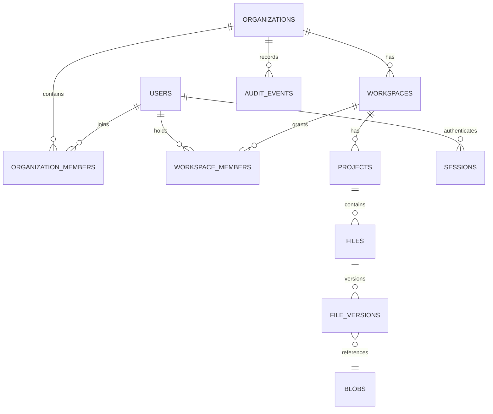

# Datenmodell und Mandantengrenzen

## Entitäten

| Entity | Felder (Konzept) | Invarianten |
|---|---|---|
| `users` | id UUID, normalized_email, display_name, password_hash?, disabled_at, created_at | E-Mail eindeutig je Instanz; kein Klartextpasswort |
| `sessions` | id, user_id, token_hash, created_at, expires_at, revoked_at, device_id | Token nur gehasht; revocation sofort wirksam |
| `organizations` | id, slug, name, created_at, owner_user_id | Name nicht als Sicherheitsgrenze benutzen |
| `organization_members` | org_id, user_id, role, status | Unique `(org_id,user_id)`, Rolle validiert |
| `workspaces` | id, org_id, slug, name, quota_bytes, created_at | org_id unveränderbare Tenant-Grenze |
| `workspace_members` | workspace_id, user_id, role | Kein Scope-Übergriff; Org-Membership Vorbedingung |
| `projects` | id, org_id, workspace_id, name, archived_at | Muss im Workspace derselben Org liegen |
| `files` | id, org_id, project_id, filename, app_id, content_type, head_version_id, deleted_at | Dateiname reiner Metadatenwert; kein Storage-Pfad |
| `file_versions` | id, org_id, file_id, version_no, parent_version_id, blob_id, checksum, byte_size, committed_by, created_at | Immutable; Head mit CAS/ETag |
| `blobs` | id, org_id, storage_key, sha256, size_bytes, status, created_at | Fertig nur nach validiertem Schreibvorgang |
| `upload_sessions` | id, org_id, file_id?, actor_id, reserved_bytes, expires_at, status, idempotency_key | Ablauf, quota, owner; kein dauerhafter Token |
| `invitations` | id, org_id, email, role, token_hash, expires_at, accepted_at, revoked_at | Zeitlich begrenzt, einmalig |
| `audit_events` | id, org_id, actor_id?, action, object_type, object_id, request_id, occurred_at | Append-only nach Möglichkeiten, keine Secrets |
| `share_links` (later) | id, scope, token_hash, max_uses, expires_at, revoked_at | Kein öffentliches Share-Feature im MVP |

## Beziehungen

## Umsetzungsstand (PR-003)

Implementiert und migriert (`crates/craftcloud-db/migrations/`): `users`, `organizations`, `organization_members`, `workspaces`, `workspace_members`. Die Tenant-Grenze wird per **zusammengesetzten Fremdschlüsseln** erzwungen: `workspaces` hat `UNIQUE (org_id, id)`; `workspace_members` verweist mit `(org_id, workspace_id)` auf `workspaces (org_id, id)` und mit `(org_id, user_id)` auf `organization_members (org_id, user_id)`. Damit kann ein Workspace-Mitglied weder zu einem Workspace einer anderen Organisation gehören noch ohne Org-Mitgliedschaft existieren. Alle Fremdschlüssel sind `ON DELETE RESTRICT`. Migration 0003 ergänzt `instance_setup`, eine Singleton-Tabelle (`id boolean PRIMARY KEY CHECK (id)`, `operator_user_id` mit aufgeschobenem Fremdschlüssel), die den abgeschlossenen One-Shot-Bootstrap festhält; die Setup-Transaktion belegt diese Zeile zuerst und serialisiert damit parallele Versuche. Migration 0004 ergänzt `sessions` (nur SHA-256-Hash des Tokens, `last_seen_at`, absolutes Ablaufdatum, `revoked_at`; keine IP, kein User-Agent) und `password_reset_tokens` (Hash, Ablauf, `used_at`, ausstellender Operator oder NULL für die CLI). Es gibt bewusst keinen Unique-Index auf `users.instance_role`: mehrere Operatoren sind später möglich. Sessions, Einladungen, Audit, Projekte und Dateien folgen in späteren PRs.

## Wichtige Designregeln

- Alle tenant-gebundenen Datensätze tragen `org_id`, obwohl sie über FKs indirekt zuordenbar wären; verhindert versehentliche Cross-Org-Abfragen und erleichtert Policy/Partitionierung. FK-/Constraint-Design muss das tatsächlich erzwingen.
- Explizite UUID als stabile API-IDs, nicht Dateinamen oder Tabellenzähler. `slug` ist lediglich eine Benutzeroberflächenhilfe.
- Jedes neue `file_version` ist immutable; die `files.head_version_id` wird in einer DB-Transaktion mit CAS aktualisiert; Versionszähler innerhalb einer Datei monoton.
- Orphan/blob-gc geschieht erst nach Aufbewahrungs-/Backup-/Retention-Fenster; niemals sofort nach Soft-Delete.
- Zeitpunkte in UTC mit Datenbanktyp `timestamptz`; am Rand formatieren; keine selbst geschriebenen Kalenderalgorithmen.
- Auditdaten enthalten Actor, Tenant, Objekt, Zeitpunkt, Entscheidung – keine Roh-Credentials, Auth-Tokens oder vertraulichen Datei-Inhalte.

## Daten- & Löschlebenszyklus

Create → active → archive (optional) → soft delete → retention → hard delete (operator policy). Wiederherstellbarkeit und DSGVO-Erasure-Abläufe sind von Audit-Aufbewahrung, externen Backups und Speicherbackend abhängig; technische Regelung und Datenschutzprüfung notwendig.
