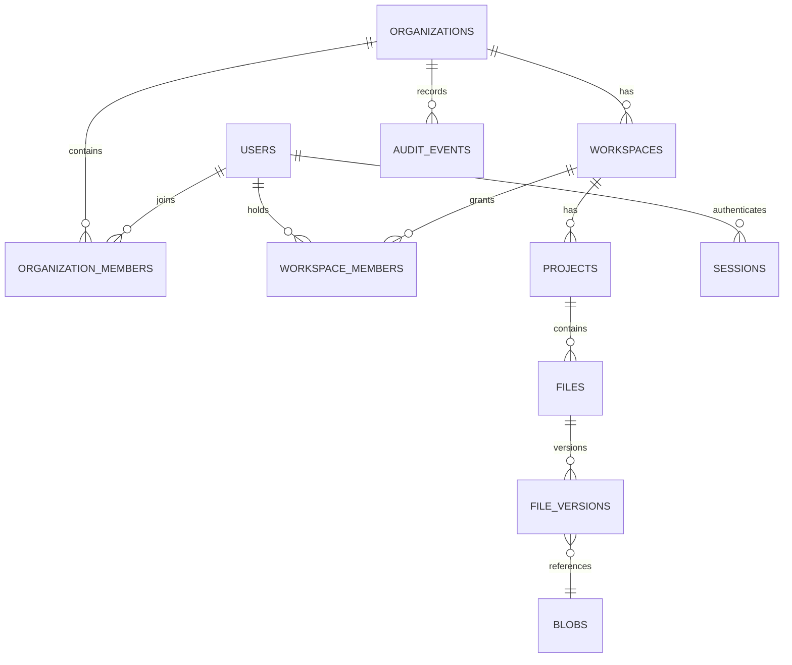

# Datenmodell und Mandantengrenzen

## Entitäten

| Entity | Felder (Konzept) | Invarianten |
|---|---|---|
| `users` | id UUID, normalized_email, display_name, password_hash?, disabled_at, created_at | E-Mail eindeutig je Instanz; kein Klartextpasswort |
| `sessions` | id, user_id, token_hash, created_at, expires_at, revoked_at, device_id | Token nur gehasht; revocation sofort wirksam |
| `organizations` | id, slug, name, created_at, owner_user_id | Name nicht als Sicherheitsgrenze benutzen |
| `organization_members` | org_id, user_id, role, status | Unique `(org_id,user_id)`, Rolle validiert |
| `workspaces` | id, org_id, slug, name, quota_bytes, created_at | org_id unveränderbare Tenant-Grenze |
| `workspace_members` | workspace_id, user_id, role | Kein Scope-Übergriff; Org-Membership Vorbedingung |
| `projects` | id, org_id, workspace_id, name, archived_at | Muss im Workspace derselben Org liegen |
| `files` | id, org_id, project_id, filename, app_id, content_type, head_version_id, deleted_at | Dateiname reiner Metadatenwert; kein Storage-Pfad |
| `file_versions` | id, org_id, file_id, version_no, parent_version_id, blob_id, checksum, byte_size, committed_by, created_at | Immutable; Head mit CAS/ETag |
| `blobs` | id, org_id, storage_key, sha256, size_bytes, status, created_at | Fertig nur nach validiertem Schreibvorgang |
| `upload_sessions` | id, org_id, file_id?, actor_id, reserved_bytes, expires_at, status, idempotency_key | Ablauf, quota, owner; kein dauerhafter Token |
| `invitations` | id, org_id, email, role, token_hash, expires_at, accepted_at, revoked_at | Zeitlich begrenzt, einmalig |
| `audit_events` | id, org_id, actor_id?, action, object_type, object_id, request_id, occurred_at | Append-only nach Möglichkeiten, keine Secrets |
| `share_links` (later) | id, scope, token_hash, max_uses, expires_at, revoked_at | Kein öffentliches Share-Feature im MVP |

## Beziehungen

## Umsetzungsstand (PR-003)

Implementiert und migriert (`crates/craftcloud-db/migrations/`): `users`, `organizations`, `organization_members`, `workspaces`, `workspace_members`. Die Tenant-Grenze wird per **zusammengesetzten Fremdschlüsseln** erzwungen: `workspaces` hat `UNIQUE (org_id, id)`; `workspace_members` verweist mit `(org_id, workspace_id)` auf `workspaces (org_id, id)` und mit `(org_id, user_id)` auf `organization_members (org_id, user_id)`. Damit kann ein Workspace-Mitglied weder zu einem Workspace einer anderen Organisation gehören noch ohne Org-Mitgliedschaft existieren. Alle Fremdschlüssel sind `ON DELETE RESTRICT`. Migration 0003 ergänzt `instance_setup`, eine Singleton-Tabelle (`id boolean PRIMARY KEY CHECK (id)`, `operator_user_id` mit aufgeschobenem Fremdschlüssel), die den abgeschlossenen One-Shot-Bootstrap festhält; die Setup-Transaktion belegt diese Zeile zuerst und serialisiert damit parallele Versuche. Migration 0004 ergänzt `sessions` (nur SHA-256-Hash des Tokens, `last_seen_at`, absolutes Ablaufdatum, `revoked_at`; keine IP, kein User-Agent) und `password_reset_tokens` (Hash, Ablauf, `used_at`, ausstellender Operator oder NULL für die CLI). Migration 0005 ergänzt `organizations.version` (ETag/`If-Match`, Start bei 1) und einen Index für die Organisationslisten. `organization_members.created_at` hält den Beitrittszeitpunkt (Sortierung und Cursor der Mitgliederliste ohne personenbezogene Daten). Mitgliedschaften haben die Status `active`, `invited`, `disabled`: nur `active` zählt als Mitglied; Hinzufügen aktiviert eine `invited`/`disabled`-Zeile mit Nicht-Owner-Rolle erneut, Entfernen löscht eine Zeile jedes Status. Die Spalte `organizations.owner_user_id` hält den Nutzer, für den die Organisation angelegt wurde; maßgeblich für Eigentum ist die Mitgliedsrolle `owner` (mindestens ein aktiver Owner je Organisation, serialisiert über eine Zeilensperre der Organisation). Beim Entfernen eines Mitglieds werden dessen Workspace-Zuweisungen in dieser Organisation mitgelöscht (Zugriffsrechte, keine Nutzdaten). Es gibt bewusst keinen Unique-Index auf `users.instance_role`: mehrere Operatoren sind später möglich. Sessions, Einladungen, Audit, Projekte und Dateien folgen in späteren PRs.

## Umsetzungsstand (PR-007)

Migration 0006: `workspaces.version` (ETag), `workspace_members.created_at`, `organizations.workspace_admin_invites_enabled` (Standard `true`) und die Tabelle `invitations` (eigene Tabelle; der Mitgliedsstatus `invited` wird nicht verwendet und bleibt nur historisch im Schema). Eine Einladung speichert nur den SHA-256 des Tokens, die normalisierte Adresse, die Organisationsrolle (`admin`/`member`, nie `owner`), optional Workspace und Workspace-Rolle (zusammengesetzter Fremdschlüssel `(org_id, workspace_id)`), Ersteller, Ablauf (72 h) und die Zeitstempel `accepted_at`, `revoked_at`, `invalidated_at`. `users` erhält `email_verified_at` (bis zu einer Verifikation für alle Konten NULL, auch den Setup-Operator) und `created_via_invitation_id` (FK auf `invitations`, `RESTRICT`; Herkunftsorganisation und Einlader sind darüber ableitbar). Ein partieller eindeutiger Index erlaubt je Organisation und Adresse höchstens eine offene Einladung. Abgelaufene offene Zeilen werden beim Anlegen einer neuen Einladung für dieselbe Adresse geschlossen (`invalidated_at`).

Sperrreihenfolge (immer in dieser Richtung, damit es keine Verklemmungen gibt): Organisationszeile → Nutzerzeilen → Einladungen/Sitzungen/Tokens. Kontenpfade sperren zuerst Nutzerzeilen und nehmen nie Organisationssperren. Das Annehmen sperrt Organisation, teilt die Sperre auf Einlader und Zielkonto und verbraucht die Einladung mit `UPDATE ... WHERE accepted_at IS NULL AND revoked_at IS NULL AND invalidated_at IS NULL AND expires_at > now`.

## Umsetzungsstand (PR-008)

Migration 0007: `projects` (je Workspace, Fremdschlüssel `(org_id, workspace_id)` auf `workspaces`, `UNIQUE (org_id, workspace_id, id)`) und `files` (Fremdschlüssel `(org_id, workspace_id, project_id)` auf `projects`; damit sind mandantenübergreifende Zeilen unmöglich). Beide tragen `version` (ETag `"prj-v<n>"` bzw. `"file-v<n>"`), Ersteller/Bearbeiter (`RESTRICT` auf `users`, Dateien überleben das Entfernen von Mitgliedern) und `deleted_at`/`deleted_by_user_id` für den Papierkorb. Der Name ist untrusted Anzeigemetadatum; `name_key` (NFKC und Casefold; der angezeigte Name bleibt NFC wie getippt, von der Anwendung berechnet) steckt in einem partiellen eindeutigen Index über SHA-256 des Schlüssels (Spalte `name_hash`, per Trigger gepflegt) über die nicht gelöschten Zeilen (je Workspace bzw. je Projekt). Dateien haben `size_bytes` (0), `sha256` und `head_version_id` (beide `NULL`, die Fremdschlüssel auf Versionen kommen mit einer späteren Migration). Zeitstempel kommen aus der Uhr der Anwendung. Es gibt keine Löschroutine für abgelaufene Papierkorb-Einträge (CC-P02-06); die Sperrreihenfolge bleibt Organisationszeile, dann Projekt-/Dateizeilen.

## Umsetzungsstand (PR-010)

Migration 0008: `organizations.quota_bytes`, `reserved_bytes`, `committed_bytes` und `workspaces.reserved_bytes`, `committed_bytes` (`quota_bytes` gab es bereits; NULL = unbegrenzt). Neue Tabellen `blobs` (Mandant per `(org_id, workspace_id)`, `object_key` eindeutig, Status `staged`/`committed`/`orphaned`) und `upload_sessions` (zusammengesetzte Fremdschlüssel auf `(org_id, workspace_id, project_id, file_id)` und `(org_id, blob_id)`, Zustände `created`, `receiving`, `stored`, `committed`, `aborted`, `expired`, `failed`, `request_fingerprint` und eindeutiger `Idempotency-Key` je Nutzer). Die Zähler werden nur in der Transaktion unter der Organisationssperre geändert (Reihenfolge: Organisationszeile, dann Workspace-Zeile) und lassen sich aus Sitzungen und Blobs neu berechnen. Eine Sitzung hält ihre Reservierung in den Zuständen `created`, `receiving` und `stored` (bis der Version-Commit sie nach `committed_bytes` verschiebt).

## Umsetzungsstand (PR-011)

Migration 0009: `file_versions` (Nummer je Datei, `blob_id`, Größe, SHA-256, `base_version_id`, `restored_from_version_id`, `upload_session_id` eindeutig; zusammengesetzte Fremdschlüssel auf `(org_id, workspace_id, project_id, file_id)` und `(org_id, blob_id)`; Versionen werden nie geändert) und der Fremdschlüssel `files.(id, head_version_id)` auf die eigenen Versionen. Der Kopf wandert nur im Commit mit Compare-and-Set (`WHERE head_version_id IS NOT DISTINCT FROM <Basis>`) unter der Dateizeile; ein Restore legt eine neue Version auf den vorhandenen Blob. Blob-Status `corrupt` kommt hinzu. Ein Commit bucht die reservierten Bytes des Uploads genau einmal von `reserved_bytes` nach `committed_bytes` (Organisation und Workspace); `recompute_usage` zählt `committed` und `corrupt` Blobs. Zwei Etags einer Datei: Metadaten `"file-v<n>"` (Umbenennen) und Inhalt `"version:<uuid>"` (Kopfversion).

## Wichtige Designregeln

- Alle tenant-gebundenen Datensätze tragen `org_id`, obwohl sie über FKs indirekt zuordenbar wären; verhindert versehentliche Cross-Org-Abfragen und erleichtert Policy/Partitionierung. FK-/Constraint-Design muss das tatsächlich erzwingen.
- Explizite UUID als stabile API-IDs, nicht Dateinamen oder Tabellenzähler. `slug` ist lediglich eine Benutzeroberflächenhilfe.
- Jedes neue `file_version` ist immutable; die `files.head_version_id` wird in einer DB-Transaktion mit CAS aktualisiert; Versionszähler innerhalb einer Datei monoton.
- Orphan/blob-gc geschieht erst nach Aufbewahrungs-/Backup-/Retention-Fenster; niemals sofort nach Soft-Delete.
- Zeitpunkte in UTC mit Datenbanktyp `timestamptz`; am Rand formatieren; keine selbst geschriebenen Kalenderalgorithmen.
- Auditdaten enthalten Actor, Tenant, Objekt, Zeitpunkt, Entscheidung – keine Roh-Credentials, Auth-Tokens oder vertraulichen Datei-Inhalte.

## Daten- & Löschlebenszyklus

Create → active → archive (optional) → soft delete → retention → hard delete (operator policy). Wiederherstellbarkeit und DSGVO-Erasure-Abläufe sind von Audit-Aufbewahrung, externen Backups und Speicherbackend abhängig; technische Regelung und Datenschutzprüfung notwendig.
