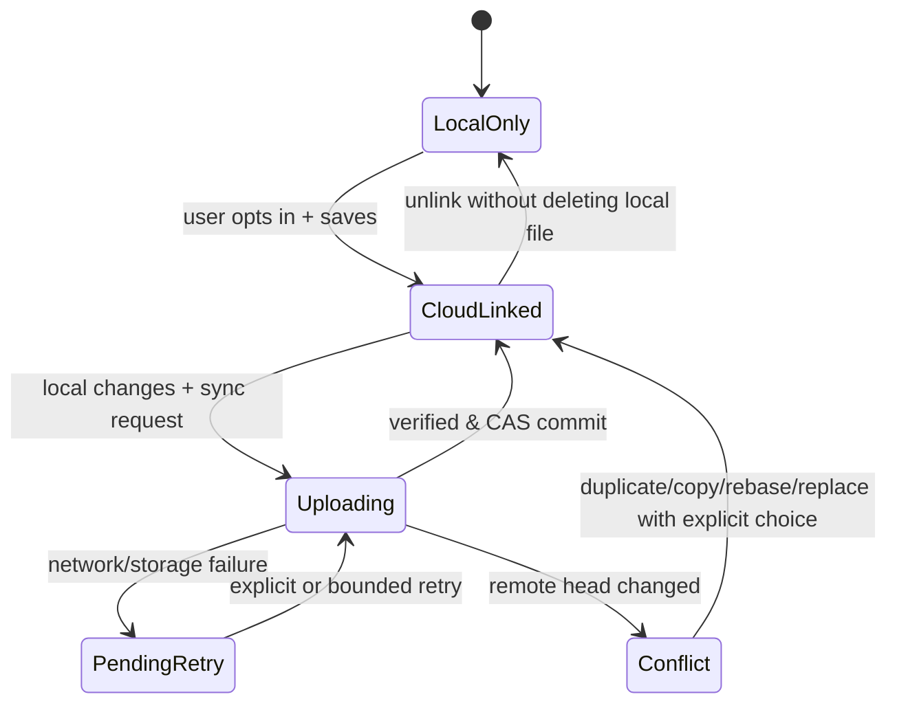

# Datei-Sync, parallele Updates, Wiederholbarkeit

## MVP: Datei-Revisionen statt CRDT

Eine Craft-App behält die lokale Kopie. Nach explizitem Cloud-Opt-in wird beim Öffnen die `base_version_id` erfasst. Speichern ist lokal unmittelbar möglich; Remote-Upload ist separate Operation, die einen neuen immutable Blob und eine neue Versionsmetadatenzeile erstellt.

## Commit-Protokoll

1. GET File head, authorized scope and quota. Client retains `base_version_id`.
2. POST Upload-Session with idempotency key and expected size/hash, receiving expiration and upload ID.
3. Stream bytes in bounded chunks; each chunk verified/acknowledged; resumability explicitly requires part manifest.
4. POST finalize verifies byte count/checksum; blob transitions to ready; no file-head change yet.
5. POST commit with `If-Match` against expected head. DB transaction creates version and moves head only on match.
6. If precondition fails: return 412 + current head; **never overwrite silently**. Preserve uploaded blob temporarily for conflict resolution or cleanup.

## Conflict UX strategies

- Default: save local unchanged and show conflict with options **Save as separate cloud file**, **Download latest and compare**, **Overwrite remote intentionally** (role-checked and with fresh precondition), **Cancel**.
- No automatic merging of binary/native project formats; only app-specific merge strategy after rigorous format contract.
- Idempotency after timeout: same key+payload returns same result; same key+different payload is 409; keys expire based on documented retention.
- Detached offline edits and removal of server link never delete the local source file.

## Test scenarios

Two devices same base; interleaved uploads; retry with dropped response; upload succeeds but DB commit fails; expired upload; file deleted mid-upload; role revoked mid-upload; exhausted quota; remote 429; stale token; corruption in local blob; conflicting same file names in folder. Every scenario has deterministic result and a recovery path.

## Umsetzungsstand (PR-011)

Schritt 5 ist umgesetzt als `POST /files/{id}/versions` mit `{"upload_id": ...}` und `If-None-Match: *` (erste Version) oder `If-Match: "version:<uuid>"` (Kopf). Bei veraltetem Kopf antwortet der Server 412 `VERSION_CONFLICT` mit `details.current_version_id` und dem aktuellen Etag; der Upload bleibt `stored` (Quota reserviert, bis er abläuft oder abgebrochen wird) und kann auf den neuen Kopf aufgesetzt (Rebase) oder mit `If-None-Match: *` als **separate Datei** im selben Workspace gespeichert werden, ohne erneut hochzuladen. "Overwrite remote intentionally" bleibt ein Commit auf den frisch gelesenen Kopf (ein Restore einer alten Version ist ebenfalls ein CAS-Commit). Idempotenz nach Zeitüberschreitung: die Upload-ID ist das Token; ein wiederholter Commit desselben Uploads liefert dieselbe Version mit 200, unabhängig von den Preconditions.
