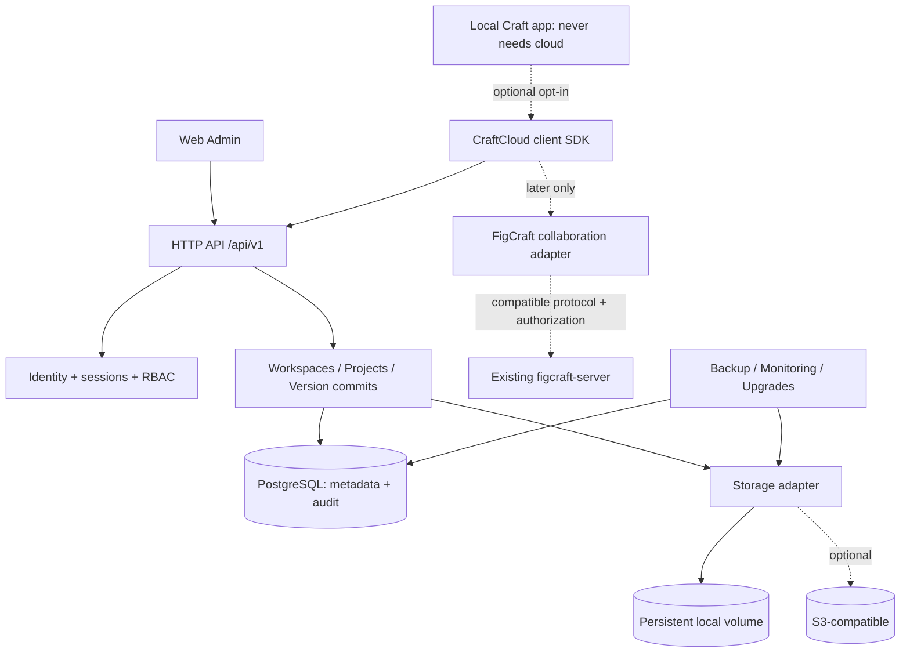

# Referenzarchitektur – CraftCloud Core

## Gesamtbild

## Trust boundaries

1. **Browser → API**: Origin, TLS, CSRF, cookies and CORS are enforced. Browser never has privileged DB/S3 credentials.
2. **Native app → API**: Separate user authorization, scoped device tokens and refresh/revocation; discovery is untrusted.
3. **API → DB**: Pool credentials restricted; query always scoped by tenant; no raw SQL from clients.
4. **API → storage**: Server-synthesized opaque object IDs, bounded streamed writes; integrity+cleanup states.
5. **Cloud → external collaboration server**: Separate authorization contract. No blind forwarding of bearer tokens or figcraft share keys.
6. **Operator**: System admin with filesystem access may read unencrypted content; do not claim E2EE.

## Major flows

- Web setup and bootstrap (one-shot admin) → org/workspace provisioning → invitation acceptance.
- File upload = initialize → receive bounded content/parts → verify SHA-256 & quota → immutable blob finalize → atomic metadata commit → version/head update with `If-Match` precondition.
- Download = authenticate → authorize target artifact and version → stream content within limits → audit access per policy.
- Offline-first = local save always succeeds locally; queued sync is user-controlled; if remote revision diverged, create conflict without destroying local edits.

## Failure domains and invariants

- DB down: API returns 503, no unauthorized reads, local Craft app still works.
- Storage down: DB metadata and content lifecycle cannot claim ready without committed blob; pending uploads expire.
- Proxy down: no cloud access, but native local project unaffected.
- Backup incomplete: restore is rejected unless DB snapshot and blob manifest have compatible restore point.
- Every `document_version` references exactly one durable, verified blob (except explicit pending/failed state excluded from ready listings).

## Deployment shape

MVP: Rust service + PostgreSQL + local volume + reverse proxy TLS; static admin assets may be served separately/from trusted origin. S3 is an adapter introduced after local storage passes. Avoid mandatory Redis, Elasticsearch, queue platform or separate microservices for MVP. Define operations from day one even in single-node mode.
