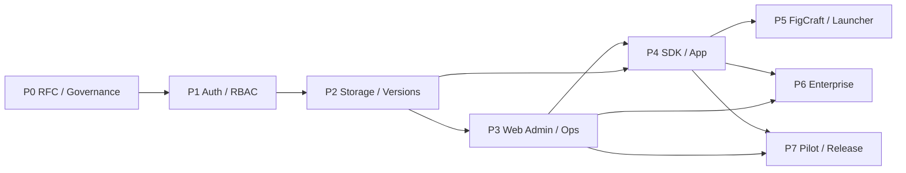

# Master-Roadmap – 8 Phasen, klare Gates

> **Planungsannahme:** Phasen sind eine **Abhängigkeitsreihenfolge**, keine Zusage zu Kalenderdaten oder Teamkapazität. Vor Umsetzung hat P0 Priorität. Umsetzung kann parallelisiert werden, aber Security-/Contract-Gates bleiben verbindlich.

| Phase | Zweck | Hauptabhängigkeit | Ergebnis |
|---|---|---|---|
| [P0](phase-00-rfc.md) | RFC, Maintainer, Standards, Lizenz | keine | Entscheidungsvorlage |
| [P1](phase-01-backend.md) | API, Auth, Tenant, RBAC | P0 | Sicheres Backend |
| [P2](phase-02-files.md) | Dateien, Versionen, Konflikte | P1 | End-to-End Blob Roundtrip |
| [P3](phase-03-dashboard.md) | Admin UI, Backups, Betrieb | P1+P2 | Self-hosted MVP |
| [P4](phase-04-sdk.md) | SDK + eine App | P2/P3 | Native App Pilot |
| [P5](phase-05-collaboration.md) | FigCraft/Launcher | P4, Maintainer | Optionale Zusammenarbeit |
| [P6](phase-06-enterprise.md) | SSO/S3/Enterprise | P3/P4 | Erweiterte Deployments |
| [P7](phase-07-release.md) | Pilot/Release Gates | P3+, je Scope | geprüfter Release Candidate |

## Must-have MVP

CC-F01 bis CC-F10 als Backend-Pflicht, CC-F11/12/14/15 für selbst hostbare Adminfähigkeit; `CC-F13` plus eine App in P4 als Integration-Demonstration. Feature-IDs referenzieren ausführliche `docs/03-features/`-Briefings.

## Phasenabhängigkeiten

## Risiken auf kritischem Pfad

1. Lizenz/Marke/Repo-Governance unklar (P0 blocker).
2. Tenant-Modell und Session-/Auth-Entscheidung (P1 blocker).
3. DB+Blob-Konsistenz, CAS und Backups (P2/P3 blocker).
4. Apps nutzen eigene Dateiformate und Kommandopipelines (P4/5, maintainer-owned).
5. `craftrules` nicht öffentlich verifiziert (P0 blocker für „vollständig upstream-konform“).

## Definition of Ready (jedes Ticket)

Problem, Grenzen, Datenmodell/API, threat model impact, negative Tests, Akzeptanzkriterien, Migration/Restore, betroffene Repos/Owner. Keine reine UI-Funktion als Ersatz für backend-seitige Policy.

## Definition of Done (jedes Ticket)

Tests tatsächlich durchgeführt und dokumentiert, keine Panics/unsafe, Contract+Docs aktualisiert, Migrationen durchgespielt, Sicherheits-/Rechteprüfungen bestanden, Review durch zuständige Maintainer. Die Phase gilt erst als abgeschlossen, wenn deren Exit-Gates nachweislich erfüllt sind.
