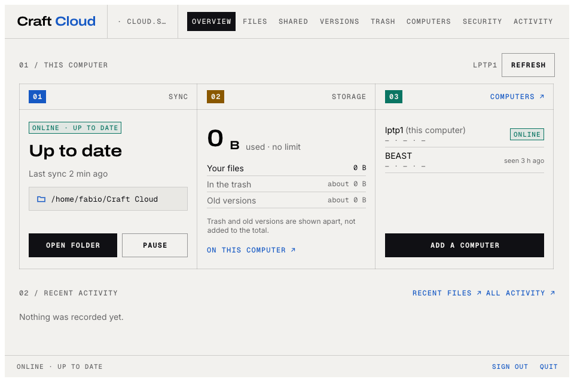
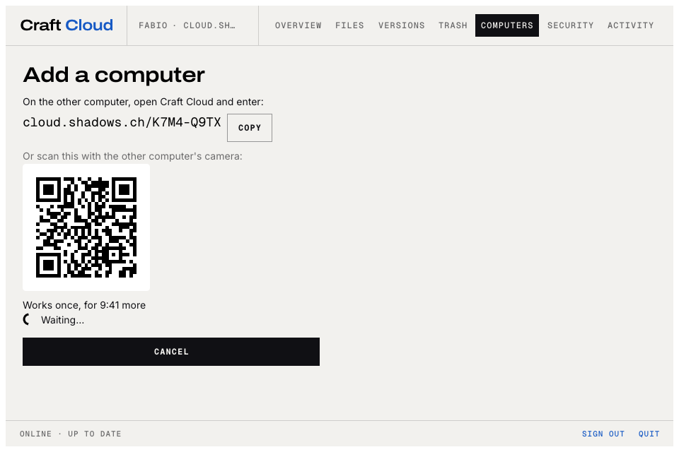

# Getting started

This page takes you from nothing to a folder that stays in sync on two computers. It assumes you have read the
[overview](overview.md), or at least know that Craft Cloud needs a server you run and the app on each computer.

## 1. Start a server

The shortest way to try the server is on one computer, with plain HTTP on `127.0.0.1:8080`. Build it, create a data
folder with the first administrator, and start it:

```sh
cargo build --release -p craft-cloud-server
printf '%s\n' 'choose a password' | ./target/release/craft-cloud-server init --dir ./cc-data --admin you
./target/release/craft-cloud-server serve --config ./cc-data/config.toml
```

The account `you` is the administrator. Its password is read from standard input, so it never appears on the command line.

For other computers to reach the server, put a TLS reverse proxy in front of it and give it a name such as
`cloud.example.org`. The agent insists on HTTPS, except for a server on the same machine. If you would rather use Docker,
which sets up the proxy and TLS for you, see [Running the server](../server.md#docker). The full guide covers storage,
accounts, backups and everything else in [Running the server](../server.md).

## 2. Get a join string

A join string is what you give a computer so that it can join your account. The administrator makes one on the server:

```sh
./target/release/craft-cloud-server user --config ./cc-data/config.toml invite you
```

Set `public_url` in `config.toml` first, so that the join string carries the address your computers will use. If you
prefer, you can skip the join string and sign in with the account name and password instead.

## 3. Install the app

Install the Craft Cloud app on the computer. The steps for Windows, macOS and Linux are on the page about
[installing and updating](install-update.md). The app installs for you alone, needs no administrator rights and puts
nothing on the desktop.

## 4. Sign in

Open Craft Cloud. The first start walks you through up to three steps, and the footer says which step you are on.

1. On the **Server** step ("Find your Craft Cloud"), type the address of your server in the **Server** field and click
   **Continue**. If you have a join string, click **Use a join string** instead, because a join string already carries the
   address.
2. On the **Account** step ("Join your Craft Cloud"), choose **Sign in** and type your **Username** and **Password**, or
   choose **Join string** and paste the string you were given. If the account has two-factor sign-in, the next step asks for
   the code from your authenticator app.
3. On the **Folder** step ("Folder and name"), check where your files will live. The default is a folder called
   `Craft Cloud` in your home folder. **Change…** picks another folder, and **This computer's name** is how this computer
   appears in lists. Click **Join** (or **Sign in**, when you used an account name).

If the folder already has files in it, the app asks first: "This folder already has files in it." **Sync them** adds them
to your cloud, and files that differ from the cloud's are kept as copies, with nothing deleted. **Choose another folder**
lets you pick a different one.

If the join string is an invite for a new account, the app adds a step, "Choose a password", where you choose the password
for that account and type it twice.

When it finishes, the app shows the Overview. The Sync cell says "Online · Up to date" once the folder has caught up, and
the folder's path is shown there. The app starts syncing by itself at every login from now on.



## 5. Add a second computer

On a computer that is already signed in, open the **Overview** tab and click **Add a computer** (the same button is on the
**Computers** tab). The app makes a one-time code and a QR code. The code works once and for ten minutes, and the page
counts down the time that is left.



On the new computer, install the app, and on the **Account** step choose **Join string** and enter the code. You can also
scan the QR code with the new computer's camera. Finish the **Folder** step as before. When the code has been used, the
first computer says so, and you click **Done**. If the code ran out, click **Make a new code**.

## Where the synced folder is

By default it is `Craft Cloud` in your home folder (`~/Craft Cloud`). The Overview shows the exact path in the Sync cell,
and **Open folder** there, or **Open folder** in the tray menu, opens it in your file manager. Save or move files into this
folder and they sync. Team spaces that you sync to a computer get their own folders, by default under a folder called
`Craft Cloud Shared`.

Next, read [everyday tasks](workflows.md) to learn what else the app can do.
