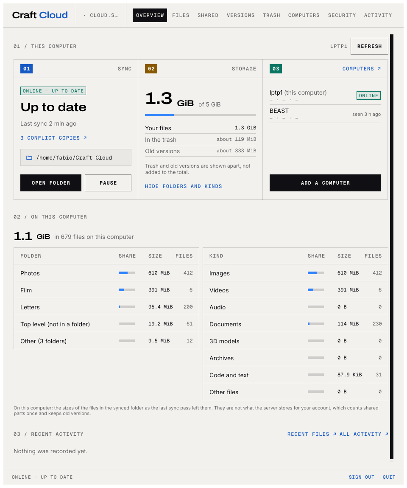

# Craft Cloud overview

Craft Cloud keeps your files in sync across your computers, and it runs entirely on a server that you control. You run the
server on your own computer, a NAS or a VPS, and you install the Craft Cloud app on every computer that should take part.
From then on the folder `~/Craft Cloud` on each of those computers stays in sync, with a version history behind it. The
Craft apps save ordinary files into that folder, so your backups and other tools see ordinary files too.

There is no hosted service and no account with anyone but you. Nothing in Craft Cloud sends information about you or your
files to anyone else.

## Who it is for

Craft Cloud is for people who use the Craft apps on more than one computer and want their projects, settings and recent
files to follow them, without handing the files to a third party. It also suits a small team that wants a shared folder
with clear roles. You should be comfortable running a small server, or have someone who is. The server guide covers that
side in detail.

## What it does

- It syncs the folder `~/Craft Cloud` between all computers signed in to your account. Large files upload in pieces, so a
  small change to a big project sends only what changed, and an interrupted upload picks up where it stopped.
- It keeps earlier versions of your files. You can see them and bring one back, and a deleted file waits in a trash until
  you remove it for good.
- When two computers change the same file at the same time, it keeps both copies instead of choosing one. A sync that
  would delete a large number of files waits for your approval first.
- It shows the recent files of every Craft app on every computer, so a file you opened on one machine is easy to find on
  another.
- It supports team spaces: a folder shared between accounts, where each person is a viewer, an editor or an owner.
- It shows how much storage your account uses, and it lets you add a computer with a one-time code and remove one you no
  longer use.
- It supports two-factor sign-in with an authenticator app.
- For the person who runs the server, it offers admin pages in the app and, if you turn them on, in a browser.

## What it does not do

- It is not a hosted service. You cannot sign up anywhere; the server you run is the only place your files live.
- It does not work with the cloud of any other vendor, and it does not read from or write to one.
- It does not sync folders other than the Craft Cloud folder and the folders of team spaces that you choose to sync.
- The admin pages in the browser are for looking after the server. They are not a place to browse or download files, and an
  administrator cannot read the files of a team space unless they are a member of it.
- It does not update itself or the server. You decide when to update, and the page on installing and updating shows how.

## What you need

You need two things: a server that you run, and the Craft Cloud app on each computer. Windows, macOS and Linux are
supported by the app. The server needs to be reachable from every computer, which in practice means a name such as
`cloud.example.org` with a TLS certificate in front of it. A server on the same computer as the app is the one exception
and works over plain HTTP.

## How the pieces fit together

The server stores the files, their versions and the accounts. The app on each computer comes with a small background
program, the sync agent, which watches the folder and talks to the server. The app is the window and the tray icon through
which you look at and control that agent. Closing the window does not stop syncing, and the agent starts again by itself at
every login.

## The rest of this guide

- [Getting started](getting-started.md) takes you from nothing to a synced folder.
- [Installing and updating](install-update.md) covers the app on each system, removing it, and updating the app and the
  server.
- [Everyday tasks](workflows.md) explains pausing, restoring files, team spaces, two-factor sign-in and more.
- [Troubleshooting](troubleshooting.md) lists what the app reports when something is wrong and what to do about it.

For the server in depth, see [Running the server](../server.md). For how the parts are built, see
[the architecture](../architecture.md), and for the security model, [security](../security.md).
