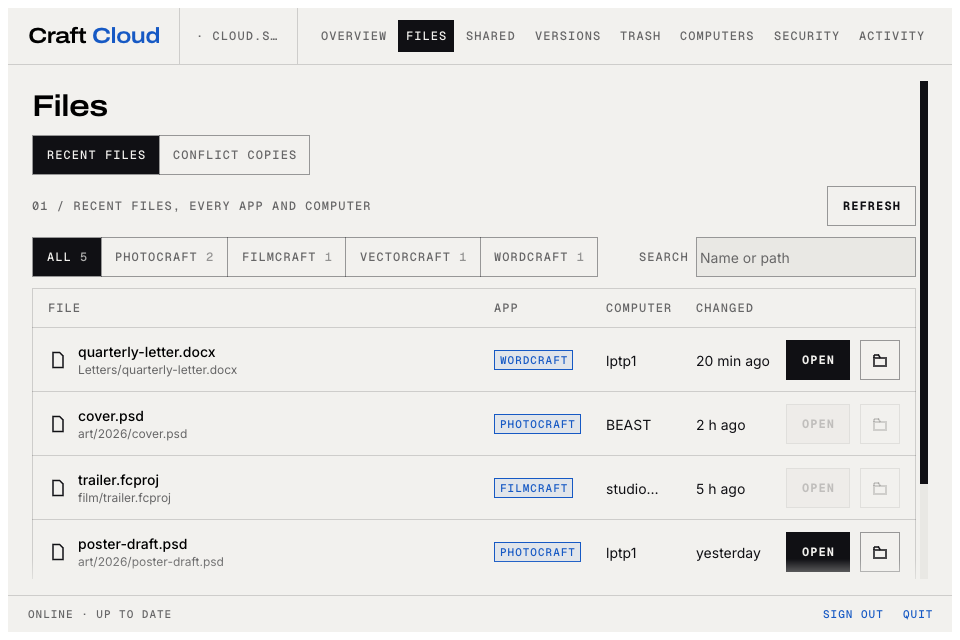
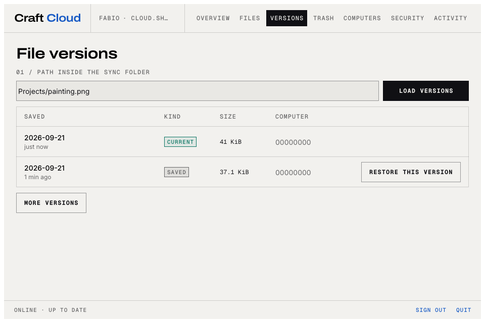
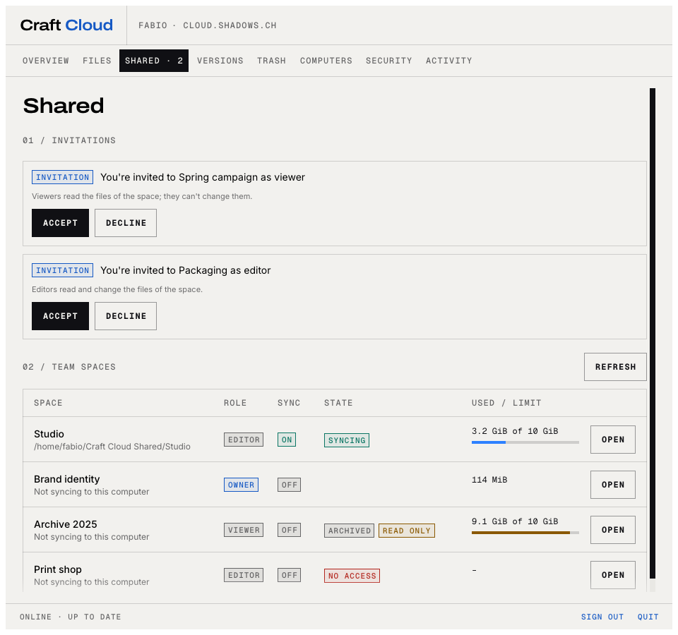

# Everyday tasks

Each section below names the tab and the buttons as the app shows them. The tabs across the top of the window are
**Overview**, **Files**, **Shared**, **Versions**, **Trash**, **Computers**, **Security** and **Activity**, plus **Admin**
if you are an administrator. Hover over a tab to see its keyboard shortcut. While a page holds a one-time code or waits for
an answer, the tabs are off, with the hint "Finish or close what the page shows first".

## Pause and resume sync

On the **Overview** tab, the Sync cell has a **Pause** button next to **Open folder**. While it is paused the line reads
"Paused: nothing syncs until you resume", and the button changes to **Resume**. The tray menu has the same **Pause** and
**Resume** entry. **Quit** in the footer or the tray is different: it stops the agent until your next login.

## See recent files

Open the **Files** tab and choose **Recent files**. It lists the recent files of every Craft app on every computer, with
the columns File, App, Computer and Changed, and **Open now** when someone has the file open. Search by **Name or path** or
pick an app to narrow the list. **Open** starts the file in its default program, and the folder button ("Show in folder")
shows it in its folder. Both are off for a file that is not on this computer. The Overview also lists the newest activity
under "Recent activity", with links to **All activity** and **Recent files**.

## Restore an earlier version of a file

Open the **Versions** tab. Type the path of the file inside the sync folder, for example `Projects/file.txt`, and click
**Load versions**. The table shows each version with the columns Saved, Kind, Size and Computer. The newest carries the
tag **Current**. Click **Restore this version** on the one you want and confirm "Restore this version?" with the same
button. This makes the chosen version the current file, and sync updates this computer. **More versions** loads older
ones. A version that shows "can no longer be restored" cannot be brought back.

## Get a file back from the trash

Deleted files and folders wait in the **Trash** tab under "Deleted items", with their kind, size, when they were deleted
and when they are "Removed for good". Click **Restore** on an item to bring it back. If something else has taken its name
meanwhile, it comes back under a different name. A folder brings back what was deleted inside it with it. **Remove** takes
an item out of the trash for good after you confirm, and it can no longer be restored from the trash. Use the filter
**All**, **Folders** or **Files**, or the **Search** field, to find an item, and **More** to load further items.

## Resolve a conflict copy

When two computers change the same file at the same time, Craft Cloud keeps both: one under the original name and the
other as a conflict copy next to it. The Overview shows a link such as "1 conflict copy" in the Sync cell. It opens the
**Files** tab on **Conflict copies**, where each copy has **Open** and **Show original**. The list is made from file
names that look like a conflict copy, so a file you named that way yourself shows up too. The app has no merge tool: open
both files, keep what you want in the original, then delete the copy in the folder.

## Make a team space from a folder

Making a team space is an administrator's change, so only an administrator sees this. On the **Overview** tab, click
**On this computer** to list the folders in the sync folder, then click **Team space…** on the folder's row. In the form,
type the **Name of the team space** and **Your password**, and, if your account has two-factor sign-in, a code from your
authenticator app or a recovery code. Click **Make the team space**. The files are copied into the new team space, and
only when it has every file, checked one by one, is the old folder deleted from this computer. It then sits in the trash on
the server, where you can restore it. You become the owner and can invite the others. A notice on the Overview shows the
progress ("In progress", "Done" or "Stopped"), with **Try again**, **Dismiss** and **Open the Shared tab**.

## Invite someone and choose a role

Only an owner invites. Open the **Shared** tab, click **Open** on the team space, and find **Invite by account name** in
the Members card. Type the person's account name, choose a role and click **Invite**. The roles are:

- **Viewer** reads the files of the space and cannot change them.
- **Editor** reads and changes the files.
- **Owner** also invites and removes people and changes their roles. A space always keeps at least one owner.

The person shows as **Invited** until they accept. An owner can change a role in the same table and click **Remove** to
take someone out. Owners can also **Rename** the space.

## Accept an invitation

When someone invites you, the **Shared** tab shows a count, for example "Shared · 1", and the Overview shows "1 invitation
to a team space". On the **Shared** tab, the Invitations list says "You're invited to … as …". Click **Accept** or
**Decline**. After you accept, the space can sync to this computer: **Sync** copies its files into a folder that Craft
Cloud picks under `Craft Cloud Shared`, **Choose another folder…** lets you pick one, and **Not now** leaves it for later.
The space page has **Sync on this computer** and **Stop syncing here** to change your mind, and **Leave this space** if you
want to go. Leaving keeps the files on this computer as a plain folder.

## Remove a computer

Open the **Computers** tab. Every computer on the account is listed with its kind, platform, version and when it was last
seen. **Rename** changes a name, and **Remove** signs a computer out at once. It cannot sync any more, and its files stay on
its disk. **Sign out other computers** signs out every computer except this one. Use **Add a computer** to make a one-time
code for a new one.

## Turn on two-factor sign-in

Open the **Security** tab and click **Set up two-factor sign-in**. Type your password and click **Continue**. Add the key to
an authenticator app, by scanning the code, using **Copy**, or using the setup link, type the six digits from the app and
click **Turn on**. The app then shows your recovery codes once. Save them somewhere safe, because each works only once if you
lose your phone, and click **I have saved them**. On the same tab, **New recovery codes** replaces the old codes, and
**Turn off** switches the feature off again, which signs your other computers out.

## Check the storage in use

The **Overview** tab has a Storage cell. It shows the size of your files and the limit ("of …", or "used · no limit"),
then "Your files", "In the trash" and "Old versions". The trash and old versions are estimates, shown apart and not added
to the total. **Refresh** reads the figures again, and **On this computer** lists the sizes of the folders and the kinds of
files in the sync folder. Those are what the folder holds here, not what the server stores for you.
